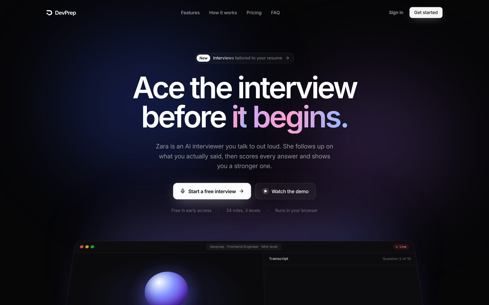
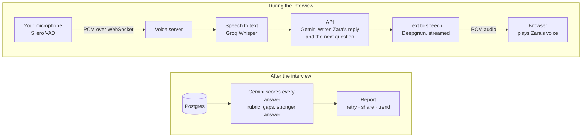

<div align="center">

<picture>
  <source media="(prefers-color-scheme: dark)" srcset=".github/assets/devprep-logo-dark.svg">
  
</picture>

# DevPrep

### Ace the interview before it begins.

Practice out loud with Zara, an AI interviewer who listens, follows up and talks back in real time.<br>
Then get a score for every answer, what was missing, and a stronger version to learn from.

[**Open DevPrep**](https://dev-prep-frontend.vercel.app) · [Demo](#demo) · [Features](#features) · [How it works](#how-it-works) · [Run it locally](#run-it-locally) · [API](#api)


<br>



</div>

---

## Why DevPrep

Most people prepare for interviews by practising alone, with generic questions, guessing what the interviewer wants, and never once saying an answer out loud. Then the real interview is the first time they have to think and talk at the same time.

DevPrep makes the practice feel like the real thing. Pick a role and a level, and Zara runs a ten-question voice interview: she asks, listens, follows up on what you actually said, and moves on like a real interviewer. When you finish, every answer is scored and explained, and you can retry any question out loud until it's right.

## Demo

https://github.com/user-attachments/assets/e849b172-3296-481f-a1bc-5e0ba44fd50e

## Features

**A real voice interview**
- **24 roles** across Engineering, Data, Product, Design and Behavioral, each at three levels: Fresher, Mid-level and Senior
- **Zara**, the AI interviewer: she opens with your introduction, then asks ten questions with follow-ups based on what you said
- **Hands-free turn taking:** voice activity detection in the browser (Silero VAD) notices when you stop talking, so there's no push-to-talk button
- **Low-latency replies:** transcription starts while you pause, so the text is ready the moment the turn ends; the API loads the session and opens its Gemini connection at the same time; and Zara's reply goes to text-to-speech a sentence or clause at a time as it's written, so she starts speaking before the whole reply is ready
- **Tailored interviews:** questions about the projects on your resume, a target job description, or both
- A live transcript of the conversation and an optional camera preview, like a real video call

**Feedback that tells you what to fix**
- A report with an **overall score out of 100**, technical, communication and confidence scores, a summary and what to practise next
- **Every answer** scored out of 10 on four skills (answering the question, technical depth, clarity, concrete examples), with what was strong, what was missing and **a stronger answer** whose highlighted parts you swap for your own experience
- **Retry any question by voice**, up to five times, and see the score change
- **Delivery:** speaking pace in words per minute and the filler words you lean on
- **Share** a read-only link to a report (scores and feedback, never your answers), and turn it off any time
- **Reports** for every interview, filtered by role, with a score trend per role

**Coding round**
- Ten problems (arrays, sliding window, stacks and queues, graphs, dynamic programming) at Easy, Medium and Hard
- A code editor in the browser; your solution runs against the tests in a Web Worker with a time limit, so an infinite loop can't freeze the page
- **AI code review** on every submission: a score, a verdict, time and space complexity, strengths, improvements and a follow-up question

**See your progress**
- An **overview** with interviews reviewed, coding problems solved and your current streak
- A score trend, an activity heatmap for the past year, and **readiness by role**, weighted toward your last three reports
- **Focus areas:** your weakest answer skill across recent interviews, with advice on how to improve it

**Career tools**
- **Resume:** upload a PDF, check it against a job description like an applicant tracking system would (match score, matched and missing skills, suggested edits) and draft a cover letter for that job
- **Applications:** a drag-and-drop board from Saved to Applied, Interviewing, Offer and Rejected, with links and notes on each one

**Built properly**
- A pnpm and Turborepo monorepo: Next.js frontend, Express API, a separate WebSocket voice server and a shared Prisma package
- Email and password or Google sign-in with JWTs; request bodies validated with Zod
- Raw 16-bit PCM audio over a single WebSocket in both directions, played back with the Web Audio API
- Each answer's evaluation is stored with its question, and every retry is kept with its own score
- An admin stats page, visible only to the emails in `ADMIN_EMAILS` (everyone else gets a 404)

## How it works



**During the interview:** the browser listens with Silero VAD and streams your answer to the voice server as 16-bit PCM while you talk. As soon as you pause, the voice server starts transcribing with Groq Whisper and asks the API to get ready (session in memory, Gemini connection open); if you carry on talking, that attempt is dropped. When the pause turns out to be the end of your answer, the transcript is already there, and the voice server passes it to the API, which saves it and streams Zara's reply and the next question back from Gemini. The voice server turns that reply into speech with Deepgram a phrase at a time as it arrives and streams the audio back to the browser.

**After the interview:** opening the report asks the API to evaluate the session. Gemini scores each answer on the rubric, lists what was strong and what was missing, and writes a stronger answer. Retries are transcribed and scored the same way, one question at a time.

<details>
<summary><b>Architecture diagram</b></summary>


</details>

## Tech stack

| Layer | Technology |
| --- | --- |
| Language | TypeScript, end to end |
| Frontend | Next.js 16, React 19, Tailwind CSS 4, shadcn/ui (Radix UI), Motion, cmdk, Recharts, CodeMirror |
| Backend | Node.js, Express 5, Zod |
| Real-time voice | WebSocket server (`ws`), Web Audio API, Silero VAD with ONNX Runtime Web |
| Database | PostgreSQL, Prisma |
| AI | Gemini (interviewer, scoring, code review, resume tools), Groq Whisper (speech to text), Deepgram (text to speech) |
| Auth | JWT, Google OAuth |
| Tooling | pnpm workspaces, Turborepo, ESLint, Vercel |

<details>
<summary><b>Project structure</b></summary>

```
DevPrep/
├── apps/
│   ├── frontend/                # Next.js app
│   │   ├── app/                 # landing page, /dashboard, interview room, shared reports (/r/[token])
│   │   ├── components/          # overview, interviews, report, coding, resume, applications
│   │   ├── hooks/               # useRealtimeVoice: VAD, WebSocket and audio playback
│   │   ├── lib/                 # API clients, the coding test runner
│   │   └── data/                # interview roles and study questions
│   ├── backend/                 # Express API
│   │   └── src/
│   │       ├── routes/          # auth, interview, resume, applications, coding, insights, admin, public
│   │       ├── controllers/     # request handlers
│   │       ├── services/        # interview engine, evaluation, delivery, coding review, resume tools
│   │       └── lib/             # Gemini client, request helpers
│   └── ws-server/               # WebSocket voice server: speech to text, text to speech, turn streaming
└── packages/
    ├── database/                # Prisma schema, migrations and client
    ├── eslint-config/           # shared ESLint config
    └── typescript-config/       # shared tsconfig presets
```

</details>

## Run it locally

You need Node.js 20+, pnpm 9 and a PostgreSQL database (local, or a free one from [Neon](https://neon.tech)). You also need API keys for Gemini, Groq and Deepgram.

```bash
git clone https://github.com/Furqan-7/DevPrep.git
cd DevPrep
pnpm install
```

Create an env file for each app:

| File | Variables |
| --- | --- |
| `packages/database/.env` | `DATABASE_URL` |
| `apps/backend/.env` (copy `.env.example`) | `DATABASE_URL`, `JWT_TOKEN`, `GEMINI_API_KEY`, `CORS_ORIGIN`, `ADMIN_EMAILS`; for Google sign-in, `GOOGLE_CLIENT_ID`, `GOOGLE_SECRET_KEY` and `GOOGLE_REDIRECT_URI`; optionally `GEMINI_JSON_THINKING_LEVEL` (default `low`) for reports, code reviews and resume tools |
| `apps/ws-server/.env` | `GROQ_API_KEY`, `DEEPGRAM_API_KEY`, `BACKEND_URL=http://localhost:3001` |
| `apps/frontend/.env.local` | `NEXT_PUBLIC_API_URL=http://localhost:3001`, `NEXT_PUBLIC_WS_URL=ws://localhost:8080`, `GROQ_API_KEY` (for retrying answers by voice) |

Then create the database tables and start everything:

```bash
pnpm --filter @repo/database build
pnpm --filter @repo/database exec prisma migrate deploy

pnpm dev    # web on :3000, API on :3001, voice server on :8080
```

Open http://localhost:3000. The interview room needs microphone access, which browsers only allow on `localhost` or HTTPS.

### Checks

```bash
pnpm lint
pnpm check-types
pnpm build
```

<details>
<summary><b>Deploying</b></summary>

- **Frontend (Vercel):** set the project's root directory to `apps/frontend`, and set `NEXT_PUBLIC_API_URL`, `NEXT_PUBLIC_WS_URL` (a `wss://` address) and `GROQ_API_KEY`.
- **API:** any Node.js host (the example env is written for Render). Build with `pnpm install --frozen-lockfile && pnpm --filter http-server... build`, start with `pnpm --filter http-server start`, and set `CORS_ORIGIN` to the frontend's address.
- **Voice server:** a Node.js host that supports long-lived WebSocket connections. Build with `pnpm --filter ws-server... build`, start with `pnpm --filter ws-server start`, and point `BACKEND_URL` at the API.
- **Database:** run `prisma migrate deploy` from `packages/database` whenever the schema changes.

</details>

## API

Routes marked 🔒 need the JWT from sign-in in a `token` header.

<details>
<summary><b>All endpoints</b></summary>

| Method | Endpoint | Description |
| --- | --- | --- |
| POST | `/api/auth/signup`, `/api/auth/signin` | Create an account or sign in with email and password |
| GET | `/api/auth/google`, `/api/auth/google/callback` | Google sign-in |
| GET | `/api/auth/me` | The signed-in user (Google sign-in keeps the JWT in a cookie) |
| POST | `/api/interview/generate` 🔒 | Start an interview for a role and level, optionally tailored to your resume or a job description |
| POST | `/api/interview/turn-stream` | One interview turn: saves the answer and streams Zara's reply (called by the voice server) |
| POST | `/api/interview/prewarm` | Loads a session into memory and warms the Gemini connection before a turn (called by the voice server) |
| POST | `/api/interview/answer` 🔒 | Submit an answer without the voice pipeline |
| GET | `/api/interview/sessions` 🔒 | Your interviews with their scores |
| GET | `/api/interview/sessions/:id` 🔒 | One interview with its questions, answers, feedback and delivery |
| POST | `/api/interview/sessions/:id/report` 🔒 | Score the interview and write its report |
| POST | `/api/interview/questions/:id/attempts` 🔒 | Retry one answer and get it scored (up to five times) |
| POST / DELETE | `/api/interview/sessions/:id/share` 🔒 | Create or remove the report's share link |
| GET | `/api/public/reports/:token` | A shared report, without the answers |
| GET / PUT / DELETE | `/api/resume` 🔒 | Read, upload (PDF, up to 5 MB) or delete your resume |
| POST | `/api/resume/match` 🔒 | Check the resume against a job description |
| POST | `/api/resume/cover-letter` 🔒 | Draft a cover letter for a job description |
| GET / POST | `/api/applications` 🔒 | List or add job applications |
| PATCH / DELETE | `/api/applications/:id` 🔒 | Move, edit or delete an application |
| GET | `/api/coding/problems` | The coding-round problems and their tests |
| GET / POST | `/api/coding/submissions` 🔒 | Your submissions, or submit a solution for an AI code review |
| GET | `/api/insights` 🔒 | Overview: stats, score trend, activity, streaks, readiness and focus areas |
| GET | `/api/admin/stats` 🔒 | Usage stats, for accounts in `ADMIN_EMAILS` only |

The frontend also has one route of its own: `POST /api/transcribe` turns a recorded retry into text with Groq Whisper.

</details>

## Author

**Bodarni Furqan**, full-stack engineer · TypeScript, Node.js, Next.js, PostgreSQL, Prisma<br>
[GitHub](https://github.com/Furqan-7) · [LinkedIn](https://linkedin.com/in/furqan-132378327) · [X](https://x.com/B_Furqan07)
